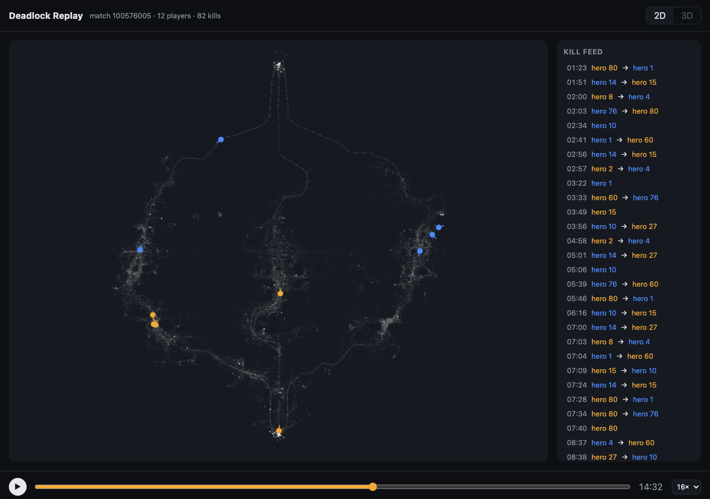

# Deadlock Replay

Watch Deadlock replays in the browser, in 2D or 3D, and draw strats on top of them.

CS2 has [Memorin](https://memorin.app) and Dota 2 has [ReplayDojo](https://www.replaydojo.com/dota2). Deadlock has no 3D replay viewer yet. This repo is building one.



## What works today

- **Parser.** `packages/parser` turns a `.dem` file into a compact timeline: every player's position, facing and health twice per second, plus the kill feed and ability casts. It runs on [deadem](https://github.com/Igor-Losev/deadem). A full 27-minute match parses in about 7 seconds.
- **2D replay.** `apps/web` plays the timeline on a minimap with play, scrub, speed and a clickable kill feed. The map outline in the screenshot is drawn from where players walked, so no Valve map art ships with the repo.
- **Share links.** `?t=14:32` opens the replay paused at that moment.

## Run it

```sh
pnpm install
pnpm dev                     # opens the 2D viewer with the sample match

fixtures/fetch.sh            # downloads the 349 MB test demo
pnpm test                    # parser + view tests against the real match
pnpm timeline fixtures/100576005-6679.dem -o timeline.json
```

## Layout

| Path | What it is |
| --- | --- |
| `packages/parser` | `.dem` → `Timeline` JSON. Runs in Node today, browser next. |
| `packages/view2d` | Canvas renderer with interpolation between sampled frames. |
| `packages/view3d` | Three.js renderer over the same timeline. [Plan](packages/view3d/README.md). |
| `apps/web` | The viewer. Static site, no backend. |
| `fixtures` | Real demos used by the tests. Not committed; fetched by `fetch.sh`. |

## How it stays cheap to run

Demos are parsed on the viewer's machine, not on a server. Loading by match ID goes through a small Worker that streams the demo from Valve's replay CDN without storing it. The site is static, and the 3D assets will sit on Cloudflare R2, which has no egress fees.

## Roadmap

See [ROADMAP.md](ROADMAP.md). Each item is one issue with its acceptance test written before work starts.

## License

MIT. Deadlock and its assets belong to Valve.
